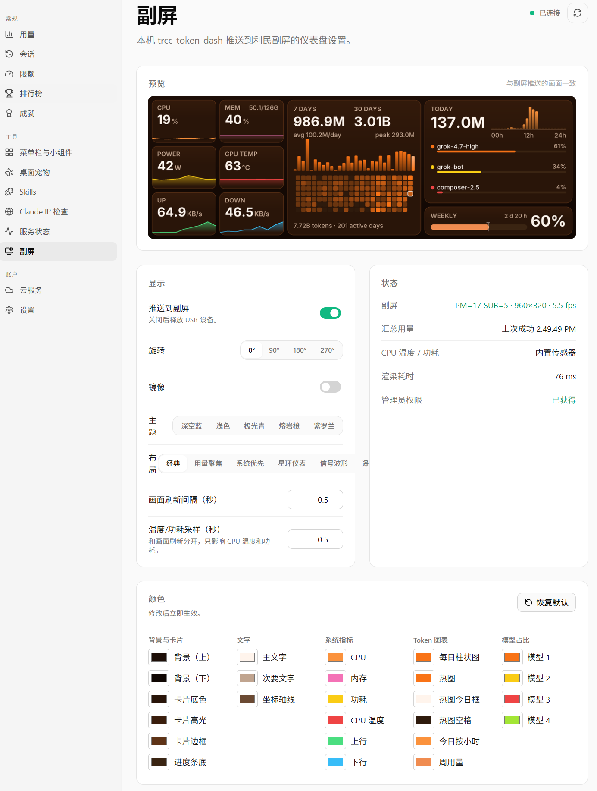

# trcc-token-dash

把 Cursor 用量 + 系统指标推到利民 HydroNous R1 副屏（USB `87AD:70DB`，960×320），带中文控制窗口。

许可证：**GPL-3.0**。副屏 Bulk 推帧协议改编自 [Lexonight1/thermalright-trcc-linux](https://github.com/Lexonight1/thermalright-trcc-linux)，见 `NOTICE`。

## TokenTracker 仪表盘（推荐）

Windows 安装版在仪表盘 **工具 → 副屏** 配置推送与主题，副屏子进程随 `tracker serve` 自动启停，无需单独开 trcc 窗口：



## 使用前

1. **先完全退出官方 TRCC**（托盘图标右键退出；必要时在任务管理器结束 `TRCC.exe`、`USBLCDNEW.exe`）。官方版和本程序不能同时占用副屏。
2. 本机 Cursor 已登录（程序从 `%APPDATA%\Cursor\User\globalStorage\state.vscdb` 读取会话，用来拉用量 CSV）。**不会上传或打印登录令牌。**
3. 功耗 / CPU 温度：程序内置 LibreHardwareMonitorLib，**以管理员身份运行**时直接读取（窗口里有“以管理员身份重启”按钮）。需要：
   - .NET 8 运行时（Windows 版 .NET Desktop Runtime 8.x）；
   - PawnIO 驱动（装过 LiteMonitor / LibreHardwareMonitor 新版即已安装）。
   非管理员时会改读正在运行的 LibreHardwareMonitor（WMI）；都没有则显示 `—`。诊断：`trcc-token-dash.exe --sensors out.txt`。

## 控制窗口

双击 `trcc-token-dash.exe` 打开窗口：

| 区域 | 功能 |
|---|---|
| 预览 | 与推到副屏的画面完全一致（含旋转/镜像） |
| 开始 / 停止推送 | 停止后立即释放 USB，此时可以重新打开官方 TRCC |
| 旋转 0° / 90° / 180° / 270° | 立即生效。本机（PM=17 SUB=5）默认 **0°** 即为正向；90°/270° 会把横版画面加黑边竖放 |
| 镜像 | 左右翻转 |
| 画面刷新(秒) | 重绘间隔，默认 1 秒（副屏保活帧另外每 0.15 秒重发一次） |
| 布局 | 选择经典、用量聚焦、系统优先、星环仪表、信号波形或遥测控制台；后三种会同时展示完整系统指标与用量概览、趋势、热图、小时分布和模型排行 |
| 主题 / 颜色 | 主题预设提供基础配色；也可自定义背景、卡片、文字和指标色，改色立即生效 |
| 恢复默认 | 旋转、布局、颜色和刷新间隔全部还原 |
| 状态栏 | 连接状态（PM/SUB/分辨率/fps）、用量读取状态、渲染耗时 |

设置自动保存到 `%LOCALAPPDATA%\trcc-token-dash\settings.json`。
**关闭窗口时**默认会询问：
- **最小化到托盘**：副屏继续推送；单击右下角托盘图标恢复窗口，右键菜单可开始/停止推送或退出。X 订阅账单由 TokenTracker 仪表盘的用量刷新按钮触发。
- **退出程序**：停止推送并释放 USB。

勾选“记住我的选择”后不再询问，可在窗口里的“关闭窗口时”下拉框随时改回“每次询问”。

## 命令行模式

```text
trcc-token-dash-cli.exe --cli              控制台模式，Ctrl+C 退出（用 build.bat cli 生成）
trcc-token-dash.exe --cli                  窗口版 exe 从 cmd 启动也可用，输出附加到当前控制台
--preview-only out.png                     只出图，不碰 USB
--once                                     推一帧就退出
--csv path.csv                             用本地 CSV，不访问 Cursor
--rotate 0|90|180|270  --mirror            覆盖设置里的旋转/镜像
--interval 1                               覆盖画面刷新间隔
--no-autostart                             打开窗口时先不推送
```

命令行模式同样读取 `settings.json` 里的颜色与旋转。

## 从源码运行 / 打包（在 TRCC-R1 上）

需要 python.org 版 Python 3.10+（安装时勾选 tcl/tk）。

```bat
cd trcc-dash
python -m venv .venv
.venv\Scripts\activate
pip install -r requirements.txt
python main.py            :: 打开窗口
python main.py --cli      :: 控制台模式
build.bat                 :: 生成 dist\trcc-token-dash.exe（窗口版）
build.bat cli             :: 另外生成 dist\trcc-token-dash-cli.exe（控制台版）
```

`vendor\libusb-1.0.dll`（libusb 1.0.26 x64）会被打包进 exe。

## 故障排查

| 现象 | 处理 |
|---|---|
| 状态栏一直显示“连接中… 无法占用 USB” | 退出官方 TRCC 后会自动重连（每 3 秒重试） |
| 未找到副屏 | 检查线材；设备管理器里应显示为 WinUSB / USBDISPLAY |
| 画面倒置 / 方向不对 | 在窗口里换旋转角度，或勾选镜像 |
| 用量一直为空 | 确认 Cursor 已登录，并在 TokenTracker 仪表盘点用量刷新；查看副屏页的状态信息 |
| 功耗/温度是 — | 以管理员身份运行 LibreHardwareMonitor 并保持运行（Options 里勾选 Run On Windows Startup 更方便） |
| Cursor 状态栏一直“刷新中” | 用量 CSV 可能有好几 MB，网速慢时首次拉取要几十秒；期间副屏照常显示缓存数据 |
| 配色改乱了 | 点“恢复默认” |
